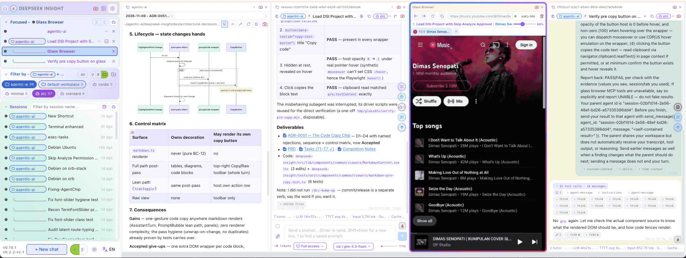

<p align="center">
	</img>
</p>

<p align="center">
	A different style opinionate <strong>DSH web client</strong> - aka <strong>DSI</strong>
<p>
<p align="center">
Screenshot: Sidebar, Workspace-explorer, Agent, Glass-browser, Subagent
<p>

#### Where you can see mulltiple **agent** / **sub-agent**, plus+ non conversation panels:
- keys panel: `Agent`, `Subagent`, `Workspace Explorer`, `Glass Browser`, `Terminal`, 
- management panel: `Prompt`, `Skill`, `Plugins` and `Configs` Manager`

> [!NOTE]
> ["in a nutshell" - DSI](https://github.com/mitmplay/dsh-insight) make `Harness` present multiple conversations (`agent` or `sub-agent`), `keys` and `management` panels **side-by-side** `INSIDE Container` that can be **re-size** or **scale**.

## Quick Start

```bash
npx @deepseek-insight/dsi@latest dsh --sync --zai
# Open http://localhost:5174
```

## Various operations can be Enter in Composer:
- `/dsi-terminal` — Open a terminal session
- `/dsi-prompts` — Open prompt manager
- `/dsi-plugins` — Open plugin manager
- `/dsi-skills` — Open skill manager

### Autocomplete (`?`)

Type `?` followed by a few letters, for example `?deploy`, and a small list appears showing the prompts you have saved before, best match first. Choosing one puts its text into the input, so you can read it and change a detail before sending. It keeps you from typing the same long prompts over and over, and from trying to remember where you saved them.

### Macros (`!`)

`!` works the same way, but choosing a prompt runs it right away instead of filling the input. Save the prompts you use every day as macros, and routines like a code review or a session summary become a single short line. Use `?` when you want to look first, and `!` when you already know what you want.

### Prompt Manager (`/dsi-prompts`)
The prompt manager is where your saved prompts live, so the `?` and `!` tricks above always have something to find. Search across everything you have kept, open a prompt to tweak its wording, flag the ones you use daily as macros, and send a keeper straight back into the input with one click. A prompt you were proud of today becomes a shortcut tomorrow.

### Plugin Manager (`/dsi-plugins`)
Plugins add whole features to DSI — the plugin manager shows what is on the rack. A simple install tab lists what you can add, uninstall lists what is already on, and each row shows the plugin's state so you always know what is running. You never touch a config file to add or remove one.

### Skill Manager (`/dsi-skills`)
Skills are the instructions your agents can follow, and this panel is their shelf. Browse what is installed group by group, tick the ones you want gone, and anything you remove can come back later. If a skill stopped being useful, it is two clicks away from being off the shelf.

### Terminal (`/dsi-terminal`)
One terminal is rarely enough when agents are working, so this one opens several, each in its own tab. Open a tab per task, keep a long build running in the background, and your tabs survive a page refresh — come back and they are still there. When a session has ended, the tab tells you instead of leaving you to guess.

### Workspace explorer
The workspace explorer is DSI's window into the folder your agents are working in. Click the workspace chip at the top of a conversation — or a file name in one of the assistant's replies — and the panel opens with that file ready. A directory tree shows the whole project, every opened file keeps its own tab so several can sit side by side, and files your agents have changed are marked in the tree, so the work is visible at a glance. One click turns any tab into a before-and-after diff when you want to see exactly what was edited.

## Included skills for:
- Coding agents: `/dsi-adr`, `/dsi-spec`, `/dsi-task`
- Integration helper for [OpenViking](https://openviking.ai/): `/dsi-ov-setup` 

**Your language.** The interface speaks English, Chinese, Indonesian & Spanish.

<details>
  <summary>Deepseek-insight-panels</summary>
  
</details>

---


- **`npx @deepseek-insight/dsi@latest`** — get latest DSI.
- `dsh` — starts **DSH** (`dsh web`) and **DSI** together, as one pair and runs it.
- `--sync` — copies DSH token to DSI config — **one window, one Ctrl-C stops both**.
- `--zai` — **optional.** It bootstraps the GLM (Z.AI) provider into the harness settings (`~/.dsh/settings.yaml`). **If you do not have a GLM account, simply leave it off** — DSI will use whatever provider your harness is already configured with.


When it is up, your browser opens the page by itself (default `http://127.0.0.1:5174`).

### Ports & the browser brain, in plain words

One "floor" is a pair: **DSH** (the harness host) and **DSI** (the page you watch). Each sits on its own port, and each port can be moved — handy when you want a second floor beside one that is already running.

| What | Default | How to move it | Plain meaning |
|---|---|---|---|
| DSH host | `3080` | `--port <n>` | the harness brain of the floor |
| DSI page | `5174` | `PORT=<n>` env var | the page you open in the browser |
| Browser brain | `9515` | `DSI_MCP_PORT=<n>` env var | the MCP endpoint agents use to drive the glass browser |

**The browser brain.** By default the glass browser's assistant (the MCP brain that lets an agent click and type in the browser) runs as its **own separate helper process** — if it fails, you lose only the glass panel. Adding `--playwright-mcp` moves that brain **inside the DSI page server**: one less background process and a faster start, but a brain failure can now touch the page server itself. DSI prints a banner saying so whenever you use the flag — drop the flag to go back to the helper process.

**Example — a second, self-contained floor beside a live one** (nothing on the running floor is touched):

```bash
PORT=5176 DSI_MCP_PORT=19515 npx @deepseek-insight/dsi@latest dsh --sync --playwright-mcp --port 3081
# Page: http://localhost:5176 · host: 3081 · brain: http://127.0.0.1:19515/sse
```

**Second floors are fully drivable.** At boot, a floor stamps its own addresses (`DSI_UI`, `DSI_MCP_URL`) into everything it starts — so agents in *that* floor's conversations drive *that* floor's glass automatically, and the preset brain entry follows the stamped port. Nothing on the primary floor changes: without a stamp (a bare `dsh web` boot), the brain falls back to `9515` and the drivers probe `5175` → `5174` exactly as before. One conversation = one glass owner; the driver refuses to touch another conversation's glass, and a session busy in the live floor shows `writer-held` if you try to prompt it from the second window (watch it there, prompt it on its own floor).

## License

[Apache-2.0](LICENSE) — Copyright © 2026 [Widi Harsojo](https://www.linkedin.com/in/wharsojo/)
> OPEN TO WORK (SG_PR)
