<p align="center">
	</img>
</p>

<p align="center">
	<strong>DSI</strong> — A Different Style of Opinionated <strong>DSH web client</strong>
<p>

<p align="center">
Screenshot: Sidebar, Workspace-explorer, Agent, Glass-browser, Subagent
<p>
<p align="center">
<strong>A multi-agent workspace where you can see multiple agents and sub-agents working side by side, alongside non-conversational content, in resizable and zoomable multi-column panels:</strong>
</p>

- keys panel: **Agent**, **Sub-agent**, **Workspace-explorer**, **Glass-browser**, **Terminal**, 
- management panel: **Prompt**, **Skill**, **Plugins** and **Configs** Manager

> [!NOTE]
> ["in a nutshell" - DSI](https://github.com/mitmplay/dsh-insight) make `Harness` present multiple conversations (**Agent** or **Sub-agent**), **keys** and **management** panels **side-by-side** `INSIDE Container` that can be **re-size** or **scale**.

# Quick Start

```bash
npx @deepseek-insight/dsi@latest dsh --sync --zai # open http://localhost:5174

DSH_VERSION=0.2.2-rc.1 npx @deepseek-insight/dsi@latest dsh --sync --zai # npm downgrade
```
When it is up, your browser opens the page by itself (default `http://127.0.0.1:5174`).

<details>
<summary><strong>CLI Params</strong></summary>
<table>
<tr><th>Argument</th><th>What it does</th></tr>
<tr><td><code>dsh</code></td><td>starts <strong>DSH</strong> (<code>dsh web</code>) and <strong>DSI</strong> together, as one pair and runs it</td></tr>
<tr><td><code>--sync</code></td><td>copies DSH token to DSI config — <strong>one window, one Ctrl-C stops both</strong></td></tr>
<tr><td><code>--zai</code></td><td><strong>optional.</strong> It bootstraps the GLM (Z.AI) provider into the harness settings (<code>~/.dsh/settings.yaml</code>). <strong>If you do not have a GLM account, simply leave it off</strong> — DSI will use whatever provider your harness is already configured with</td></tr>
</table>
</details>

## Surfaces you can work on:

<details>
<summary><strong>Sidebar</strong></summary>
<p>The sidebar is DSI's list of every conversation on this floor, kept in one slim rail so agents stay findable at a glance. Type a few letters to filter by session name, jump to a day with the date picker, tuck sub-agents out of sight when the list gets busy, and flip to the scheduler view to see what is queued to run later. When you need the full width for panels, the whole rail folds away and comes back with one key.</p>
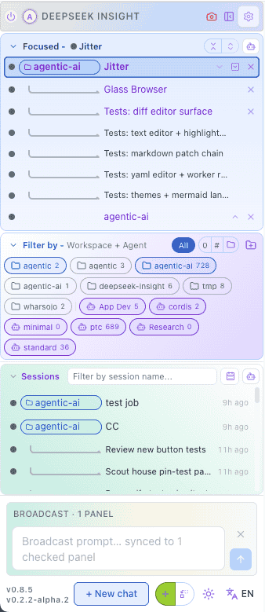
</details>

<details>
<summary><strong>Macros (<code>!</code>)</strong></summary>
<p><code>!</code> works the same way, but choosing a prompt runs it right away instead of filling the input. Save the prompts you use every day as macros, and routines like a code review or a session summary become a single short line. Use <code>?</code> when you want to look first, and <code>!</code> when you already know what you want.</p>
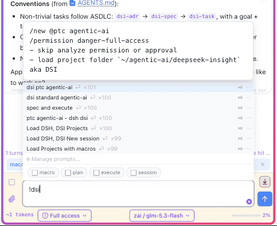
</details>

<details>
<summary><strong>Autocomplete (<code>?</code>)</strong></summary>
<p>Type <code>?</code> followed by a few letters, for example <code>?commit</code>, and a small list appears showing the prompts you have saved before, best match first. Choosing one puts its text into the input, so you can read it and change a detail before sending. It keeps you from typing the same long prompts over and over, and from trying to remember where you saved them.</p>
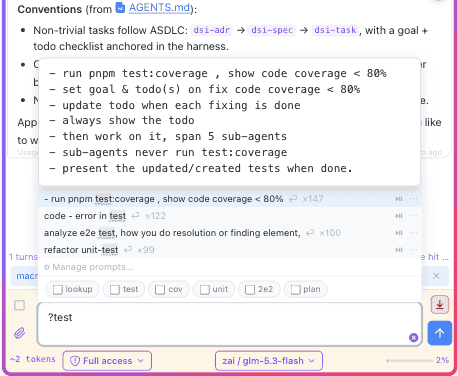
</details>

<details>
<summary><strong>Prompt Manager (<code>/dsi-prompts</code>)</strong></summary>
<ul><li><code>/dsi-prompts</code> — Open prompt manager</li></ul>
<p>The prompt manager is where your saved prompts live, so the <code>?</code> and <code>!</code> tricks above always have something to find. Search across everything you have kept, open a prompt to tweak its wording, flag the ones you use daily as macros, and send a keeper straight back into the input with one click. A prompt you were proud of today becomes a shortcut tomorrow.</p>
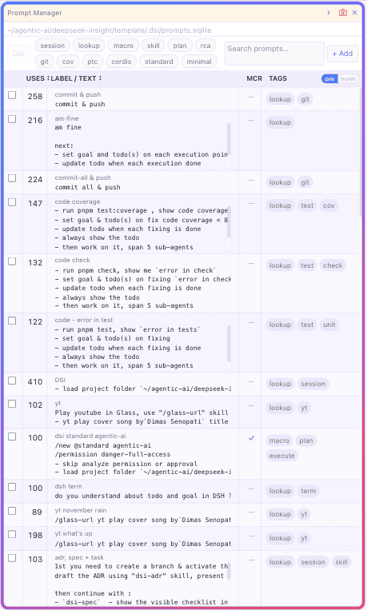
</details>

<details>
<summary><strong>Plugin Manager (<code>/dsi-plugins</code>)</strong></summary>
<ul><li><code>/dsi-plugins</code> — Open plugin manager</li></ul>
<p>Plugins add whole features to DSI — the plugin manager shows what is on the rack. A simple install tab lists what you can add, uninstall lists what is already on, and each row shows the plugin's state so you always know what is running. You never touch a config file to add or remove one.</p>
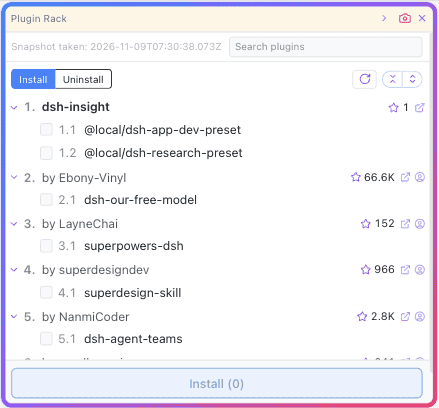
</details>

<details>
<summary><strong>Skill Manager (<code>/dsi-skills</code>)</strong></summary>
<ul><li><code>/dsi-skills</code> — Open skill manager</li></ul>
<p>Skills are the instructions your agents can follow, and this panel is their shelf. Browse what is installed group by group, tick the ones you want gone, and anything you remove can come back later. If a skill stopped being useful, it is two clicks away from being off the shelf.</p>
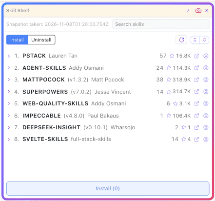
</details>

<details>
<summary><strong>Terminal (<code>/dsi-terminal</code>)</strong></summary>
<ul><li><code>/dsi-terminal</code> — Open a terminal session</li></ul>
<p>One terminal is rarely enough when agents are working, so this one opens several, each in its own tab. Open a tab per task, keep a long build running in the background, and your tabs survive a page refresh — come back and they are still there. When a session has ended, the tab tells you instead of leaving you to guess.</p>
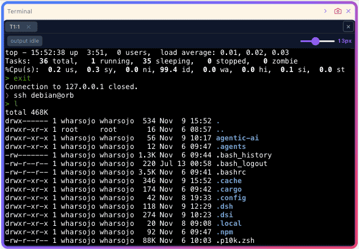
</details>

<details>
<summary><strong>Workspace explorer</strong></summary>
<p>The workspace explorer is DSI's window into the folder your agents are working in. Click the workspace chip at the top of a conversation — or a file name in one of the assistant's replies — and the panel opens with that file ready. A directory tree shows the whole project, every opened file keeps its own tab so several can sit side by side, and files your agents have changed are marked in the tree, so the work is visible at a glance. One click turns any tab into a before-and-after diff when you want to see exactly what was edited.</p>
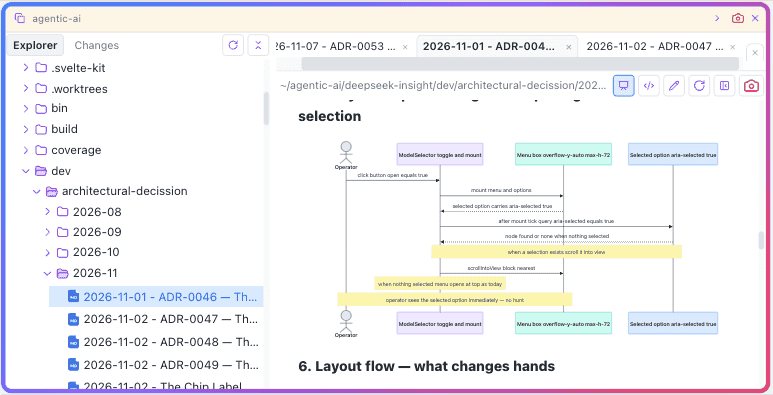
</details>

<details>
<summary><strong>Glass browser</strong></summary>
<p>The Glass browser is a real browser living inside DSI. While you work, agents build and change DSI itself — plugins, panels, settings — and instead of telling you "it's done", they can prove it: the work runs right there in the Glass panel, and you watch it live. If a plugin breaks, you see exactly what broke with your own eyes instead of trusting a green test report — the browser is the receipt.</p>
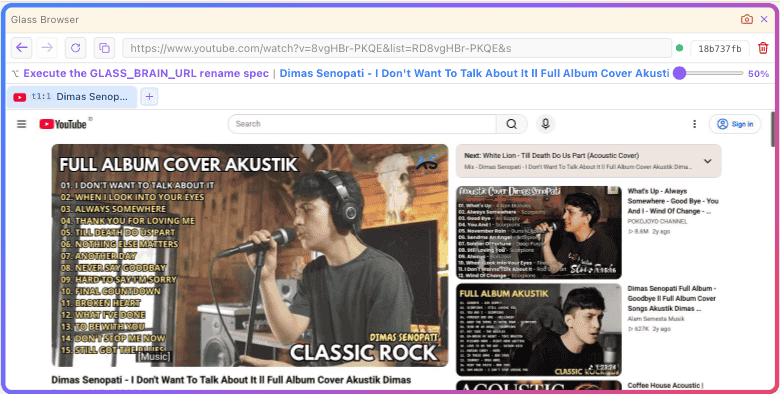
</details>

## Included skills for:
- Coding agents: `/dsi-adr`, `/dsi-spec`, `/dsi-task`
- Integration helper for [OpenViking](https://openviking.ai/): `/dsi-ov-setup` 

<details><summary>Deepseek-insight-panels</summary>
  
</details>

# Ports & the browser brain, in plain words

**Floor** is a pair: **DSI** (the page you watch), **DSH** (the harness host). Each sits on its own port, and ports can be moved — handy when you want **next floor** tobe running.

```bash
npx @deepseek-insight/dsi@latest dsh --sync --zai 
# similar commands with detail of env vars within default values
DSI_PORT=5174 DSH_PORT=3080 GLASS_PORT=9515 npx @deepseek-insight/dsi@latest dsh --sync --zai
```
<details>
<summary><strong>Env vars</strong></summary>
<table>
<tr><th>What</th><th>Default</th><th>How to move it</th><th>Plain meaning</th></tr>
<tr><td>DSI page</td><td><code>5174</code></td><td><code>DSI_PORT=&lt;n&gt;</code> env var</td><td>the page you open in the browser</td></tr>
<tr><td>DSH host</td><td><code>3080</code></td><td><code>--port &lt;n&gt;</code> or <code>DSH_PORT=&lt;n&gt;</code> env var (flag wins)</td><td>the harness brain of the floor</td></tr>
<tr><td>Browser brain</td><td><code>9515</code></td><td><code>GLASS_PORT=&lt;n&gt;</code> env var</td><td>the MCP endpoint agents use to drive the glass browser</td></tr>
<tr><td>Glass chassis</td><td><em>(this machine)</em></td><td><code>GLASS_CHASSIS_URL=&lt;url&gt;</code> env var</td><td>where Shift+click births its visible window — unset means right here</td></tr>
</table>
</details>

<details>
<summary><strong>The browser brain.</strong></summary>
<p>By default the glass browser's assistant (the MCP brain that lets an agent click and type in the browser) runs as its <strong>own separate helper process</strong> — if it fails, you lose only the glass panel. Adding <code>--playwright-mcp</code> moves that brain <strong>inside the DSI page server</strong>: one less background process and a faster start, but a brain failure can now touch the page server itself. DSI prints a banner saying so whenever you use the flag — drop the flag to go back to the helper process.</p>
<p><strong>Example — a second, self-contained floor beside a live one</strong> (nothing on the running floor is touched):</p>
<pre><code>DSI_PORT=5176 DSH_PORT=3081 GLASS_PORT=19515 npx @deepseek-insight/dsi@latest dsh --sync --playwright-mcp
# Page: http://localhost:5176 · host: 3081 · brain: http://127.0.0.1:19515/sse</code></pre>
</details>

<details>
<summary><strong>DSI in a VM, Glass on the host.</strong></summary>
<p>Run DSI/DSH inside OrbStack (or any VM) while the Glass brain stays on your Mac — that is where the headed glass can be seen (Shift+Click opens a visible Playwright window, and only the host display can show one). The VM floor boots <strong>brain-less</strong> (no brain flag — never spawn a second, invisible brain) and exports <code>GLASS_BRAIN_URL</code> pointing at the host; OrbStack exposes the Mac to its VMs at <code>host.internal</code>:</p>
<pre><code># inside the VM — floor lives here, brain dials the host
DSI_PORT=5171 DSH_PORT=3081 GLASS_BRAIN_URL=http://host.internal:9515/sse npx @deepseek-insight/dsi@latest dsh --sync</code></pre>

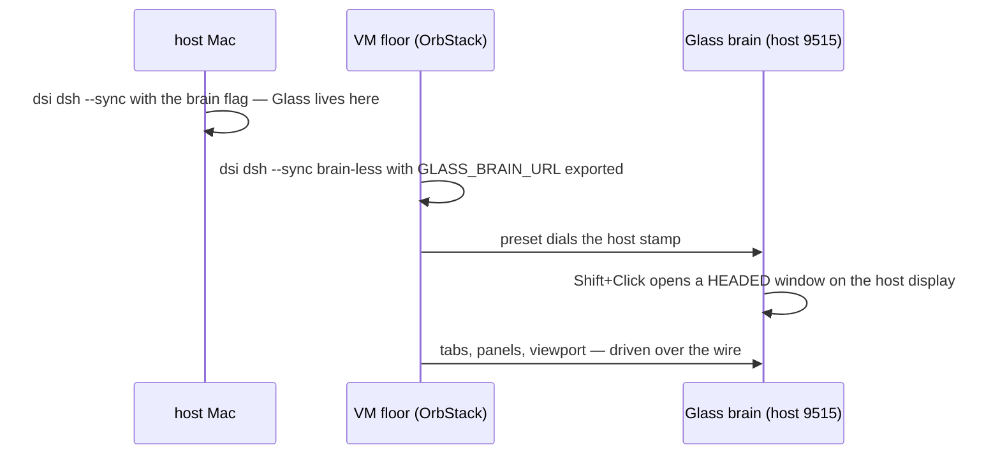

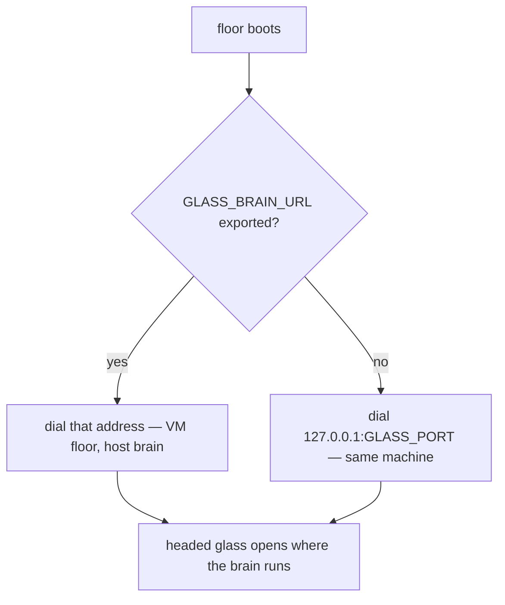

<p><strong>Second floors are fully drivable.</strong> At boot, a floor stamps its own addresses (<code>DSI_UI</code>, <code>GLASS_BRAIN_URL</code>) into everything it starts — so agents in <em>that</em> floor's conversations drive <em>that</em> floor's glass automatically, and the preset brain entry follows the stamped port. Nothing on the primary floor changes: without a stamp (a bare <code>dsh web</code> boot), the brain falls back to <code>9515</code> and the drivers probe <code>5175</code> → <code>5174</code> exactly as before. One conversation = one glass owner; the driver refuses to touch another conversation's glass, and a session busy in the live floor shows <code>writer-held</code> if you try to prompt it from the second window (watch it there, prompt it on its own floor).</p>
</details>

<details>
<summary><strong>Two glass addresses: brain vs chassis.</strong></summary>
<p>The glass has two halves and each has its own stamp. The <strong>brain</strong> (<code>GLASS_BRAIN_URL</code>) is where <em>agents</em> dial in — the MCP endpoint. The <strong>chassis</strong> (<code>GLASS_CHASSIS_URL</code>) is where a Shift+click's <em>visible window</em> is born. By default both are "this machine" and nothing changes. When DSI runs on a machine with no screen (a VM) but your screens live on the host, stamp the chassis at the host and the window opens where you are looking:</p>
<pre><code># in the VM — the window is born on the host, the panel mirrors it
node bin/dsi-chassis.mjs --bind 192.168.1.9 --port 9525   # on the HOST: the chassis companion
DSI_PORT=5171 DSH_PORT=3081 GLASS_CHASSIS_URL=http://192.168.1.9:9525 pnpm dsi dsh --sync</code></pre>
<p>The host-side <strong>companion</strong> (<code>dsi-chassis</code>) births each Shift+click glass on a fresh disposable profile — never your real Chrome profile — enforces the same one-conversation-one-glass rule on its side, binds only the address you name (never all interfaces), and bridges CDP back to the floor. When the stamp is set and the companion is down, the panel says so honestly instead of silently falling back to a screenless local launch; unset the stamp and every floor behaves exactly as before.</p>
</details>

## License

[Apache-2.0](LICENSE) — Copyright © 2026 [Widi Harsojo](https://www.linkedin.com/in/wharsojo/)
> OPEN TO WORK (SG_PR)

**Your language.** The interface speaks English, Chinese, Indonesian & Spanish.
