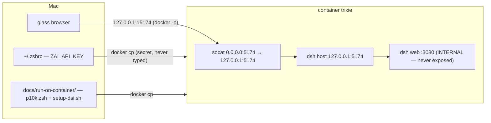
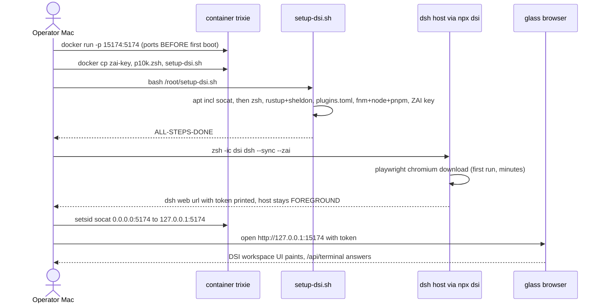

# installation in a docker container (debian, trixie)

Adapted from [the OrbStack VM doc](../running-on-vm/debian-on-orb-stack.md) —
same end state, but the target is a plain docker container (root inside, no
orb/ssh layer).

## TL;DR

Five commands on the Mac, one script, ~20 minutes (the `cargo install sheldon`
compile is the long pole). The container ends up serving the DSI web UI to
the Mac at **`http://127.0.0.1:15174/?token=…`** — port **5174 only** leaves
the container; **3080 stays internal** by design.

```sh
# 1. create with the port mapped UP FRONT (a running container cannot gain -p)
docker run -d --name trixie --hostname trixie -p 15174:5174 debian:latest sleep infinity

# 2. stage the secret + prompt config + script (all via docker cp, nothing typed)
grep '^export ZAI_API_KEY=' ~/.zshrc | head -1 > /tmp/.zai-key
docker cp /tmp/.zai-key trixie:/root/.zai-key; rm -f /tmp/.zai-key
docker cp docs/run-on-container/p10k.zsh trixie:/root/.p10k.zsh
docker cp /tmp/setup-dsi.sh trixie:/root/setup-dsi.sh

# 3. run the six-stage setup (~20 min; watch it on a desk T-tab if you like)
docker exec -it trixie bash -lc 'bash /root/setup-dsi.sh'

# 4. run DSI (interactive shell so fnm's PATH from ~/.zshrc loads)
docker exec -it trixie zsh -ic 'cd ~/agentic-ai && dsi dsh --sync --zai'

# 5. bridge the loopback-bound host out (dsh binds 127.0.0.1 INSIDE the
#    container — docker -p cannot forward to a container's loopback)
docker exec -d trixie bash -c \
  'setsid socat TCP-LISTEN:5174,bind=$(hostname -i | awk "{print \$1}"),fork,reuseaddr TCP:127.0.0.1:5174 </dev/null >/dev/null 2>&1 &'
# then open: http://127.0.0.1:15174/?token=<token from the dsh web: line>
```

Battle-tested live 2026-11-19 on `trixie` (debian:trixie, Kiri
context): full setup + sync + web UI verified in the operator's browser
(`/api/terminal` answering, sidebar painted at v0.13.x). Requires DSI
**≥ 0.13.2** — earlier releases shipped an unresolvable `workspace:*`
dependency and `npx` failed silently (see the 0.13.2 entry in
[releases.md](../../releases.md)).

## How the pieces connect





## Differences from the OrbStack doc

- ⏭️ skip `orb sudo passwd` / `ssh debian@orb` — you are already **root**
  inside the container; `sudo` does not exist and is not needed.
- ⏭️ skip OrbStack key injection — access is `docker exec -it {container} bash`.
- ✅ `usermod -s zsh root` — the doc's preferred shell switch, applied to root.
- ✅ `socat` added to the apt list — it is the loopback→eth0 bridge (below).
- ✅ ZAI_API_KEY is copied from the **Mac's** `~/.zshrc` via `docker cp` into
  `/root/.zai-key`, then appended to `/root/.zshrc` by the script — the value
  is never typed on the live terminal, so it never lands in scrollback.
- ⏭️ no p10k wizard — pre-stage [p10k.zsh](p10k.zsh) before the first zsh
  reconnect and the wizard never fires (p10k auto-sources `~/.p10k.zsh`); if
  it does fire anyway, `q` skips it and
  `echo 'POWERLEVEL9K_DISABLE_CONFIGURATION_WIZARD=true' >>! ~/.zshrc`
  stops it re-firing.

## The script (one shot, all six stages)

Stage the script on the Mac, then `docker cp` it in and run it on the desk
terminal so the operator watches progress paint live:

```sh
# on the Mac
docker cp /tmp/setup-dsi.sh trixie:/root/setup-dsi.sh
docker exec trixie chmod +x /root/setup-dsi.sh
# then, on the desk terminal (T-tab), inside the container prompt:
bash /root/setup-dsi.sh; echo LAUNCH-EXIT-$?
```

`/tmp/setup-dsi.sh`:

```bash
#!/usr/bin/env bash
# DSI setup for trixie (Debian trixie container) — adapted from docs/running-on-vm/debian-on-orb-stack.md
set -e
echo "=== STEP 1/6 apt packages ==="
apt update
export DEBIAN_FRONTEND=noninteractive
apt install -y \
  zsh vim curl git unzip pkg-config cargo build-essential libssl-dev socat \
  libnspr4 libnss3 libatk1.0-0t64 libatk-bridge2.0-0t64 libcups2t64 \
  libxkbcommon0 libasound2t64 libgbm1 libcairo2 libpango-1.0-0 \
  libxcomposite1 libxdamage1 libxfixes3 libxrandr2 libatspi2.0-0t64 \
  fonts-noto-core fonts-noto-cjk fonts-noto-color-emoji
echo "=== STEP 2/6 zsh as shell ==="
usermod -s "$(which zsh)" root
echo "=== STEP 3/6 rustup + sheldon (few minutes) ==="
curl -fsSL https://sh.rustup.rs | sh -s -- -y --profile minimal
source "$HOME/.cargo/env"
cargo install sheldon
echo "=== STEP 4/6 zshrc + sheldon config ==="
printf '%s\n' 'export PATH="$HOME/.cargo/bin:$PATH"' 'eval "$(sheldon source)"' >> ~/.zshrc
mkdir -p ~/.config/sheldon
cat > ~/.config/sheldon/plugins.toml <<'EOF'
shell = "zsh"

[templates]
defer = "{{ hooks?.pre | nl }}zsh-defer source \"{{ file }}\"\n{{ hooks?.post | nl }}"

[plugins]

[plugins.powerlevel10k]
github = "romkatv/powerlevel10k"

[plugins.zsh-defer]
github = "romkatv/zsh-defer"

[plugins.base16]
github = "chriskempson/base16-shell"

[plugins.oh-my-zsh]
github = "ohmyzsh/ohmyzsh"

[plugins.zsh-syntax-highlighting]
github = "zsh-users/zsh-syntax-highlighting"
apply = ["defer"]
EOF
echo "=== STEP 5/6 fnm + node 26.13.0 + pnpm ==="
curl -fsSL https://fnm.vercel.app/install | bash
export PATH="$HOME/.local/share/fnm:$PATH"
eval "$(fnm env)"
fnm install 26.13.0
fnm use 26.13.0
fnm default 26.13.0
npm install -g pnpm
echo "=== STEP 6/6 ZAI_API_KEY ==="
if [ -f /root/.zai-key ]; then
  grep -q 'export ZAI_API_KEY=' ~/.zshrc || cat /root/.zai-key >> ~/.zshrc
  echo "ZAI_API_KEY written to ~/.zshrc (value not printed)"
else
  echo "ZAI_API_KEY NOT AVAILABLE in this exec env — needs manual copy"
fi
echo "=== ALL-STEPS-DONE ==="
```

Stage 6's key file is prepared on the Mac before the run (secret never typed):

```sh
# on the Mac — copy the key out of ~/.zshrc straight into the container
grep '^export ZAI_API_KEY=' ~/.zshrc | head -1 > /tmp/.zai-key
docker cp /tmp/.zai-key trixie:/root/.zai-key
rm -f /tmp/.zai-key
```

## Reconnect & run dsi-insight

- `exit` the bash, then `docker exec -it trixie zsh -ic` — **use
  `-ic`, not `-l`**: fnm's PATH block lives in `~/.zshrc`, which only loads
  for interactive shells (`zsh -l` silently has no `node`).
- One known transient: sheldon's first plugin clone can fail on a DNS hiccup
  (`failed to resolve address for github.com`) — `~/.cargo/bin/sheldon lock`
  retries it and ends `SHELDON-OK-0`.
- `mkdir -p ~/agentic-ai && cd ~/agentic-ai`
- `npx -y @deepseek-insight/dsi@latest dsh --sync --zai`
  - requires DSI ≥ 0.13.2 (the registry fix); first run downloads playwright
    chromium + the pinned DSH host — minutes.
  - the host runs FOREGROUND — the end state, not a hang. It prints
    `dsh web: http://127.0.0.1:3080/?token=…`; the token is what the Mac URL
    needs.

## Expose 5174 to the Mac (the loopback trap)

Three facts stack up here, each earned the hard way on 2026-11-19:

1. **`-p` cannot be added to a running container** — publish `15174:5174` in
   the original `docker run`. To add it later: `docker commit` → `docker rm -f`
   → `docker run` with the port (the commit preserves the installed setup).
2. **dsh binds the container's loopback** (`127.0.0.1:5174`), and docker `-p`
   forwards to the container's **eth0**, not its loopback → a bridge is
   required: `socat TCP-LISTEN:5174,bind=<container-eth0-ip>,fork,reuseaddr
   TCP:127.0.0.1:5174` (started with `setsid … </dev/null &` so it survives
   the `docker exec` session).
3. **`bind=0.0.0.0` fails with EADDRINUSE** — Linux refuses a wildcard bind
   while a specific `127.0.0.1` bind holds the port; bind the socat to the
   eth0 IP (`hostname -i`) instead. And **3080 stays internal**: the Mac's own
   DSI floor already owns `127.0.0.1:3080`, so the web port must never be
   published.

Then from the Mac: **`http://127.0.0.1:15174/?token=<token>`** — verified in
the operator's browser (workspace UI paints, `/api/terminal` answers).
