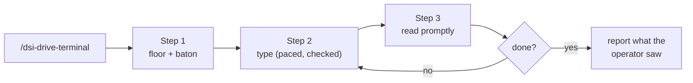
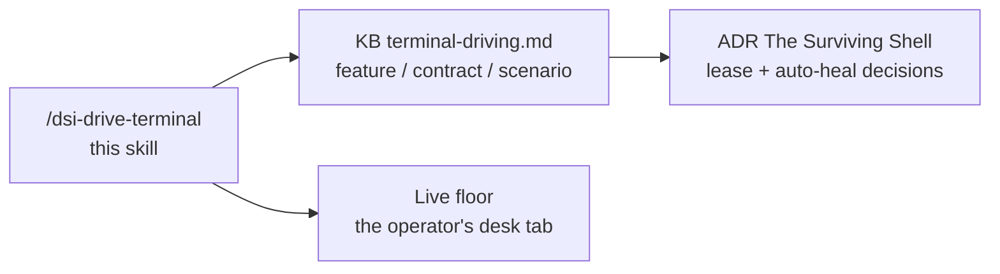

# Drive Terminal

One goal → a live terminal session driven over DSI's terminal wire with
curl: take the baton, type like a human, read what the shell said — while
the operator watches the same bytes paint their desk tab.

## SYSTEM PROTOCOL: THE BATON LAW

The session's write token is a baton with ONE holder. Every rule below
instantiates it (ADR The Surviving Shell 2026-09-24 + amendments
2026-11-04; mechanics: `dev/feature-contract-scenario/terminal-driving.md`):

### 1. BATON ETIQUETTE (who may type)
- Take the baton (`reattach`) only when about to write; a refused write
  (`403 FOREIGN_SESSION`) means heal — reattach once, retry the SAME
  keystroke — never retry blind, never re-mint in a loop.
- The operator's tab heals identically (their first key after your takeover
  shows the heal badge); watching is token-free, so displays never break.

### 2. THE DESK IS THE UX (what the operator sees)
- Run commands UNPIPED — the operator watches progress paint live; `| tail`
  a build they are watching and you have hidden their own terminal.
- The PTY echoes reality: no echo = the write was refused or the shell is
  busy. NEVER type while a command is still running (keystrokes go into
  that process's stdin, silently).

### 3. ESCAPE THE SILENT EATER (writes say `written:true`, nothing executes)
- An interactive prompt is consuming stdin — met live: `git push` username
  prompt, open commit editor, package-manager approve prompt.
- Escape: `\u0003\u0003` (Ctrl+C ×2), or ESC + `:qa!\r` (vi family), then a
  marker (`echo ALIVE\r\n`) to confirm the prompt answers.

### Enforcement Rules
- Every write response MUST be checked: `{"written":true}` or handled
  (`403` → heal, `409 SEND_ACTIVE` → wait, `400` → fix the body).
- **The receipt is necessary, never sufficient**: a dead session still
  answers `written:true` (known trap — `session.ts` silently no-ops an
  exited target; honest refusal deferred). Completion gates on ECHO +
  the exit marker in the ring, never on the receipt alone. A receipt
  with no echo → check `GET /api/terminal` `exited` first, silent
  eater second (RCA 2026-11-04).

---

## When to Use

- User says `/dsi-drive-terminal {what to run}` or "drive T1"
- User asks to install/build/run something "on the terminal" while their
  desk tab is the surface they will judge
- Agent needs to execute on a remote box the operator's shell is SSH'd into

### Step 0: No Params — Usage Guide

When the user sends `/dsi-drive-terminal` with no arguments:

1. Ask which session and what to run:
2. Reply with a usage guide — NOT execution

**Response format:**

```
📋 **Drive Terminal** — No inputs specified. I need two things:

1. **Session** — the desk tab (T1, T2, …) or "open a new one"
2. **Command / goal** — what to run, e.g. "pnpm install then build"

Usage: `/dsi-drive-terminal {session} {command}`
```

**Rules:**
- If the goal spans many commands, confirm the order before typing
- Do NOT take the baton until the goal is confirmed

## Pipeline



---

## Step 1: Floor + Baton ⛔ MANDATORY

Resolve the floor port by PROBE, never by memory of a previous session:

```sh
PORT=5175   # only after a listener probe confirms it
curl -s http://127.0.0.1:$PORT/api/terminal            # list sessions
curl -s -X POST http://127.0.0.1:$PORT/api/terminal/$ID/reattach -o /tmp/t.json
TOK=$(sed 's/.*"token":"\([^"]*\)".*/\1/' /tmp/t.json)
OFF=$(sed 's/.*"fromByte":\([0-9]*\).*/\1/' /tmp/t.json)
```

- No live session → `POST /api/terminal` opens one (new T-tab on the desk).
- `403`/foreign responses on write → heal: reattach, retry the same write.
- **Resolve the session id from evidence, never from the tab position.**
  The desk badge names its session: `T{position}:{id}` (`T1:7` = tab
  index 1, session `t-7`; splits join with `+`, unassigned tabs show
  plain `Tn`). Cross-check `GET /api/terminal` (`exited` flag) — the
  live trap: desk tab "T1" drove session `t-7` while `t-1` was an hour
  dead, and 69 keystrokes vanished (RCA 2026-11-04, "The Surface That Only
  Ever Said Yes").

---

## Step 2: Type ⛔ MANDATORY

Build the JSON body with node — never inline-quote shell strings (one bad
escape is a silent `BAD_REQUEST`):

```sh
node -e 'const fs=require("fs");const tok=fs.readFileSync("/tmp/t1-token","utf8").trim();
fs.writeFileSync("/tmp/t1-cmd.json",JSON.stringify({token:tok,action:"write",data:"uname -a\r\n"}))'
curl -s -X POST http://127.0.0.1:$PORT/api/terminal/$ID/send \
  -H 'content-type: application/json' --data-binary @/tmp/t1-cmd.json
```

- **Human pace when the operator watches**: one char per write, ~120 ms
  apart, each response checked `{"written":true}`. Faster bursts hit the
  write fence and DROP characters (live: `sudo apt update` →
  `sudoaptupdate`, zsh "command not found").
- **Passwords**: same pacing; PTY echo is off — the secret never lands in
  scrollback, the desk shows dots.
- **End every long command with a marker**: `; echo STEP-DONE-$?` — the
  marker is the completion gate (exit code included).

---

## Step 3: Read ⛔ MANDATORY

```sh
curl -s "http://127.0.0.1:$PORT/api/terminal/$ID/output?fromByte=$OFF"
```

- `$OFF` captured BEFORE the command; read right after it finishes.
- ANSI strip: `sed 's/\\u001b\[[0-9;?]*[a-zA-Z=]//g; s/\\u0007//g; s/\\r\\n/\n/g; s/\\n/\n/g; s/\\r//g'`
- Empty/short read → the ring rotated; re-read `fromByte=0` (full retained
  ring) or re-run redirecting output to a file and `cat` a slice.

---

## Step 4: Silent Eater ⛔ MANDATORY

Writes say `written:true` but nothing executes or echoes → an interactive
prompt is consuming stdin (credential prompt, commit editor, approve
prompt). Escape per SYSTEM PROTOCOL §3, confirm with a marker, re-send.

---

## Drive Checklist — MANDATORY

This is the ONLY checklist output to the user. Declared at the start,
verified at the end.

```
📋 drive-terminal: {session} — {goal}

   [ ]  1.1  ⛔ Floor port probed (listener confirmed, not assumed)
   [ ]  1.2  ⛔ Baton taken (reattach → token + offset captured)
   [ ]  1.3  ⛔ Session id resolved from badge suffix / sessions list — NOT assumed from the tab position
   [ ]  2.1  ⛔ Every write response checked (written / healed / refused)
   [ ]  2.2  ⛔ Long commands carry an exit marker; completion gated on it
   [ ]  2.4  ⛔ Receipt cross-checked by echo + marker (dead sessions answer written:true)
   [ ]  2.3  ⛔ Operator-paced typing (≈120 ms/char, verified) when watched
   [ ]  3.1  ⛔ Output read from pre-captured offset, promptly
   [ ]  3.2  ⛔ Ring misses recovered (fromByte=0 or file+cat)
   [ ]  4.1  ⛔ Any silent eater escaped (Ctrl+C / :qa!) and marker-confirmed
   [ ]  4.2  ⛔ Dead-session eater ruled OUT via GET /api/terminal exited flag (RCA 2026-11-04)
   [ ]  5.1  ⛔ Commands ran UNPIPED — the operator could watch everything
   [ ]  5.2  ⛔ Report states what the desk showed, not just what was read

   ⛔ Behavioral Commitments:
   [ ]  I will NOT retry a refused write blind — heal (reattach) first
   [ ]  I will NOT type while a command is still running
   [ ]  I will NOT pipe or silence output the operator is watching
   [ ]  I will NOT send keystrokes into an unverified prompt state
   [ ]  I will NOT claim success without the exit marker in the read
   [ ]  I will re-output this checklist at each step transition
   ━━━━━━━━━━━━━━━━━━━━━━━━━━━━━━━━━━━━━━━━━━━━━━━━
```

### Check-Off Rules

- Re-output the checklist with `[✅]` / `[🔄]` / `[ ]` at each step
  transition (1→2, 2→3, 3→4).
- At completion, output the final checklist: ALL `[✅]`, any `[❌]`.
- Do NOT deliver without the final checklist.
<!-- RCA: AI-Research/LLMs Skip Mandatory Steps/001. LLMs Skip Mandatory Steps/002.The Visible checklist Pattern/2026-06-11 - The Visible Checklist Pattern - AI Research v1 - report.md -->

---

## How This Skill Connects to the Docs

The skill is the DO-path; the docs carry the WHY and the CONTRACT.



## Attention-Degradation Protection

This skill stays SHORT. The mechanics and contract live in the KB note
(`dev/feature-contract-scenario/terminal-driving.md`); the decisions live in
the ADR. This skill only orchestrates the drive.
<!-- RCA: AI-Research/YT-Research/2026-06-22 - Why Long Instructions Make AI Dumber - Attention Degradation Science.md -->
